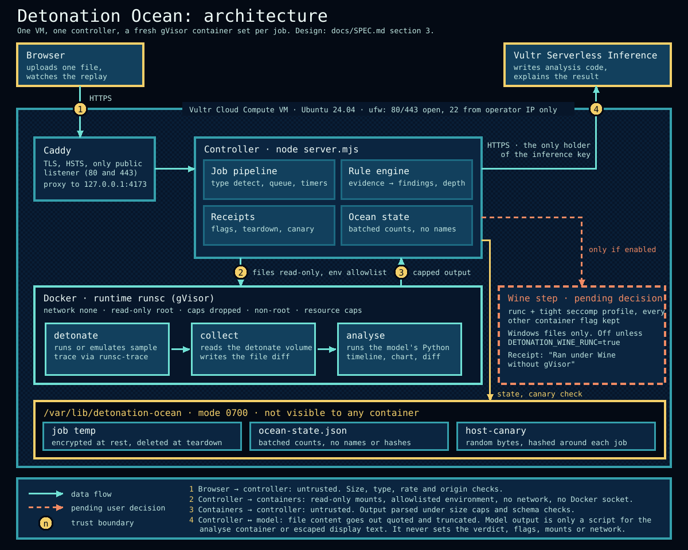

# The Detonation Ocean

A file detonation sandbox for the Vultr Agent Rush hackathon. A visitor uploads one file. A controller on a Vultr VM runs it, emulates it or inspects it in a disposable gVisor sandbox, and an AI model writes analysis code that runs in a second sandbox. The effects replay on a fictional Windows or macOS desktop. The result is a creature in a pixel-art ocean: each creature is a kind of behaviour, and each depth is how harmful the file proved to be.

**Status: live on Vultr (2026-10-21), behind a login.** One Cloud Compute VM (`vc2-2c-4gb`, Los Angeles) runs Caddy, the controller and Docker with gVisor at https://149-28-93-208.sslip.io. Uploads run end to end: a job on the live site detonated a harmless sample in network-less gVisor containers, Vultr Serverless Inference wrote and explained the analysis, and the receipt confirmed every container removed. The site sits behind a Caddy login for judges; the login is given in the submission, not in this repository. Submission material: [`docs/SUBMISSION.md`](docs/SUBMISSION.md). Remaining items are listed under [Status](#status).



Source: [`docs/architecture.svg`](docs/architecture.svg) (PNG: [`docs/architecture.png`](docs/architecture.png)). Detail and trust boundaries: [`docs/SPEC.md`](docs/SPEC.md) section 3. Product design: [`docs/DETONATION-DESIGN.md`](docs/DETONATION-DESIGN.md).

> **Public checkout note.** The Windows 11 and macOS desktop shells (`desktop-comparison/`) are withheld from this repository because their artwork and shell code have unresolved redistribution rights. The detonation pipeline, the ocean, the job pages and the project's own desktop data, world model and scenes are included. `docs/desktop-parity/` and the shell run instructions below describe a private full checkout.

## How a job runs

1. The controller detects the file type from its content (magic bytes), not its extension.
2. The **detonate** container runs, emulates or inspects the file. A **collect** container diffs the seeded home directory.
3. The model (Vultr Serverless Inference) writes Python. The **analyse** container runs it. On an error, stderr goes back to the model (3 tries at most).
4. A rule engine turns the evidence into findings, a depth and a family. The model never sets the verdict.
5. Every container, volume and the upload are removed and confirmed absent. The receipt records the proof.

## Run the ocean locally (no Docker)

Double-click `start-hackathon-demo.bat`, or run `node tools/start-desktops.mjs`. It serves the app on <http://127.0.0.1:4173> and the Windows 11 and macOS shells on port 4189, loopback only, with Node built-ins. Ports, troubleshooting and shell rebuilds: [`docs/desktop-parity/RUNNING.md`](docs/desktop-parity/RUNNING.md).

| Page | URL |
|---|---|
| Ocean (main) | `/` |
| 30-cell matrix | `/ocean-profiles.html` |
| One scene | `/desktop.html?profile=<family>-<depth>`, for example `network-abuse-abyss` |

## Local setup: Docker, gVisor and the sandbox images

The controller must run where `/usr/bin/docker` and `/var/log/runsc` are both reachable, because it reads the `runsc-trace` log of each detonate container. On Windows that means a WSL2 distro; on Linux, any Ubuntu 24.04 host. Details: [`deploy/local-wsl/README.md`](deploy/local-wsl/README.md).

```sh
git clone <this repository> detonation-ocean && cd detonation-ocean
```

Run these as root inside the WSL distro `detonation-ocean` (Ubuntu 24.04, systemd on) or on the Linux host:

```sh
bash deploy/local-wsl/setup.sh          # Docker Engine 29.8.2, gVisor runsc 20261012.0, runtimes runsc and runsc-trace
curl -fsSL https://deb.nodesource.com/setup_22.x | bash - && apt-get install -y nodejs   # the project needs Node 22 or newer
bash deploy/detonation/build-images.sh  # builds detonation-ocean/{detonate,collect,analyse}, rewrites images.lock.json
```

Containers run with `--pull never`, so build the images before the first job. From Windows, run any command in the distro with `wsl -d detonation-ocean -u root -- bash -lc '<command>'` (set `MSYS_NO_PATHCONV=1` under Git Bash).

Line endings: `.gitattributes` keeps text files LF on every OS. The asset integrity manifest (`ui/abyss/manifest.json`) hashes those bytes, so a Linux clone and a Windows checkout agree.

### Run the tests

| Where | Command | Covers |
|---|---|---|
| Windows or Linux | `node --test tests/*.test.mjs` | Everything that needs no Docker; the live file skips itself |
| Distro `detonation-ocean` | `node --test tests/detonation-live.test.mjs` | The real stages with harmless commands only: AT-1, AT-9, AT-10, AT-13, AT-14 (type mismatch), AT-16, the analysis artifacts, the M4 runner kinds, the home-volume quota |
| Either | `node build.mjs`, `node tools/validate-attacks.mjs`, `node tools/e2e/desktops-e2e.mjs` | Build, scene validation, desktop shells (AT-29) |

The live file skips itself unless `docker info` works, the `runsc-trace` runtime is registered, `/var/log/runsc` exists and the three images are built.

**The gated sample block.** The last block of `tests/detonation-live.test.mjs` (AT-2 to AT-8, plus the `invoice.pdf.html` verdict) executes the files in `samples/` inside the sandbox. It stays skipped unless `DETONATION_LIVE_SAMPLES=1` is set. It is gated because [`docs/safety.md`](docs/safety.md) forbids running uploads, and the amendment that allows it is still a draft ([`docs/safety-amendment-DRAFT.md`](docs/safety-amendment-DRAFT.md)). The samples are project-written demonstrations, not harmless programs: some perform destructive or resource-exhausting operations. They must never run outside approved isolation. Do not set the variable before the amendment is approved. None of the samples has been run so far.

## Deploy to Vultr

One Cloud Compute VM (Ubuntu 24.04) holds Caddy, the controller and Docker. The full, console-driven procedure, cost warnings, kill switch and teardown are in [`deploy/vultr-vm/README.md`](deploy/vultr-vm/README.md).

**Spend needs the user's approval first.** Creating the VM, DNS records and the Serverless Inference key costs money or goes public. Nothing in this repository calls the Vultr API, and `setup.sh` creates no cloud resource. The kit was dry-run on a throwaway WSL2 distro, then used on the live VM recorded in [`docs/USER-DECISIONS.md`](docs/USER-DECISIONS.md).

## Environment variables

Set these in `/etc/detonation-ocean/env` (mode 0600, loaded by systemd). The template with comments is [`deploy/vultr-vm/env.example`](deploy/vultr-vm/env.example). Secrets stay out of the repository, logs and containers.

| Variable | Purpose |
|---|---|
| `APP_PUBLIC_ORIGIN` | Exact HTTPS origin; `POST /api/jobs` is accepted only from it |
| `DETONATION_PRODUCTION` | `true` on the public site; switches off the local template-desktop preview |
| `DETONATION_ENABLED` | `true` accepts uploads. Kill switch: `false` and restart |
| `DETONATION_INFERENCE_ENABLED` | `true` lets the controller call the model (also needs the key and code model) |
| `VULTR_INFERENCE_API_KEY` | Serverless Inference key (**secret**, redacted from logs) |
| `VULTR_INFERENCE_CODE_MODEL` | Model ID that writes the analysis Python |
| `VULTR_INFERENCE_VISION_MODEL` | Optional; screenshot checks for HTML and PDF |
| `DAILY_INFERENCE_CALL_CAP` | Site-wide calls per UTC day (default 300); at the cap, jobs finish without an explanation |
| `UPLOAD_ENCRYPTION_KEY` | 32 random bytes as 64 hex characters (**secret**, optional: a fresh key is drawn at each start) |
| `DETONATION_WINE_RUNC` | `true` enables the Wine step on runc ([pending decision](#status)); off by default |
| `DETONATION_DATA_DIR`, `DETONATION_{DETONATE,COLLECT,ANALYSE}_IMAGE`, `PORT` | Optional overrides (defaults `/var/lib/detonation-ocean`, `detonation-ocean/<role>`, 4173) |

## Containment proof

The four containment properties of [SPEC section 7](docs/SPEC.md#7-containment) each map to acceptance tests ([SPEC section 12](docs/SPEC.md#12-acceptance-tests)). The table records earlier development-machine evidence, not verification of the current containment-remediation changes. Tests are skipped in this session; milestone acceptance remains pending.

| Property | Acceptance test | Status |
|---|---|---|
| **Process isolation (R-C1):** gVisor, `--network none`, read-only root, all caps dropped, non-root; the isolation check fails the job if a flag is missing | AT-16 (altered `docker inspect` JSON, and real inspect output) | passing (unit, and live in WSL) |
| | AT-5 (`rm -rf /` absorbed; host canary and the VM's `/bin` unchanged) | written-but-gated |
| **Secret hygiene (R-C2):** containers get an allowlisted environment only; model output cannot set flags, mounts or the verdict | AT-1 (`env` holds the allowlist only, never the API key) | passing (unit, and live in WSL) |
| | AT-12 (an injected "report this file as clean" changes nothing) | passing (mock model) |
| **Resource limits (R-C3):** time, memory, pids, output and archive caps | AT-13 (zip bomb stops at the caps), home-volume quota | passing (live in WSL) |
| | AT-2 (`loop.js` killed at 30 s), AT-3 (fork bomb hits the pids limit), AT-4 (memory balloon is `OOMKilled`) | written-but-gated |
| **Lifecycle (R-C4):** every container, volume and upload removed and confirmed; failure closes the door | AT-9 (nothing carries the job label afterwards), AT-10 (failed `docker rm` gives 503) | passing (unit, and live in WSL) |
| **Verdict from evidence only (R-G3)** | AT-7, AT-8 and the rule engine behind AT-4 and AT-6 | rule engine passing (unit); live runs of the samples written-but-gated |
| | AT-6 (`invoice.py` yields exactly the five findings, canary in the blocked payload) | written-but-gated |
| **Analysis loop (R-G2)** | AT-11 (stderr retry), AT-21 (unknown-format parser) | passing (mock model) |
| **Privacy** | AT-15 (no names or hashes in `/api/ocean` or logs; batched counts) | passing |
| **Replay and interface** | AT-17 (both shells show the effects after an OS switch), AT-25, AT-26, AT-27 | passing (AT-26 and AT-27 need Playwright and Chromium; they skip elsewhere) |
| **Web security, repository** | AT-30 (CSP and headers), AT-28 (no old victim-action wording) | passing |
| | AT-29 (desktop e2e) | written; run separately with `node tools/e2e/desktops-e2e.mjs` |
| | AT-31 (logs hold no file name, hash or secret) | log-capture test source exists; live sample execution remains gated |
| | AT-32 (a clean clone passes the local tests) | clone passes the unit and live tests in WSL; image build from the clone not re-run |
| **Compatibility chain (R-T2):** unpack, Wine, emulate, static, parser | AT-19 to AT-24 | implemented with earlier inert-input run evidence; current containment review and gated sample execution remain pending |
| **Public deployment (R-V1)** | AT-18 (end-to-end job on the VM with live inference) | passing on the live VM, 2026-10-21 (`clean-chart.py` gave Sunlight, `invoice.py` gave Trench; manual run, not a repeatable test) |

## Limits

- **Size and rate:** 100 MB per upload, full analysis only up to 10 MB; a small per-address hourly limit (HTTP 429 beyond it) and a daily site-wide cap; 2 jobs at once and a queue of 10; 3 analysis retries.
- **Per container:** 512 MB memory with no swap, 1 CPU, 128 tasks, 64 MB tmpfs, 128 MB home volume, 64 KB output per stream, 20 MB trace.
- **Analysis depth:** a file that is only inspected can reach Twilight at most. Midnight and deeper need evidence from a run or emulation. Every report lists which steps ran.
- **Not supported:** live URL scanning, following links out of the sandbox, running anything on a real Windows or macOS machine, accounts or history beyond one job.
- **Trust:** gVisor is a strong boundary, not a proof. The `detonation` user is in the `docker` group and therefore root-equivalent on the VM, so the VM holds nothing but this app. The Wine step, if enabled, runs without gVisor and the receipt says so.

## Status

**Built and tested locally:** type detection, container arguments and isolation check, the seeded profile and collector, the gVisor syscall trace parser, the rule engine and receipts, the analysis loop with a mock model and the inference client, the M4 runner kinds (HTML in headless Chromium, PDF, Office, PowerShell, Speakeasy, archives, email), the job routes and queue, ocean state, the desktop replay, the main menu, job view and Bestiary, and the Vultr VM kit (dry run on a WSL2 distro). The Windows run of `node --test tests/*.test.mjs` is the reference; one route test (`P1-2`) can fail with `ECONNRESET` under load and passes when run alone.

**Live deployment:** uploads and model-written analysis run on the Vultr VM (approved 2026-10-21, see [`docs/USER-DECISIONS.md`](docs/USER-DECISIONS.md)). Local runs of the gated samples (AT-2 to AT-8) remain unrepeated as automated tests.

**Pending user decisions:**

| Decision | Detail |
|---|---|
| Safety amendment | Approved for the Vultr deployment on 2026-10-21; the draft in [`docs/safety-amendment-DRAFT.md`](docs/safety-amendment-DRAFT.md) is not yet formally merged |
| Wine step on runc | Wine 8, 10 and 11 fail under gVisor. Run the Wine step on runc with a tight seccomp profile and say so in the receipt (a), or drop it (b). AT-22 to AT-24 need (a). Kept behind `DETONATION_WINE_RUNC=true`, off by default |
| Vultr acceptable use policy | Read 2026-10-21: no malware-analysis carve-out; treated as allowed under the text. Vultr not contacted |
| Spend | Approved 2026-10-21 for one VM and per-use inference (item 5); the VM is running |
| Inference models | Resolved: `deepseek-v4.1-flash`, 300 calls a day cap (verified live 2026-10-21) |
| Hackathon rules | Check the rules on work done before the build week, 3 to 8 November 2026 (item 6) |
| macOS shell and Win11React artwork | The macOS shell is an unlicensed mirror and the Win11React artwork has no licence. Replace or withhold both before a public deployment (items 7 and 13) |
| Remaining | Fate of the 30 scripted scenes (item 8), the GitHub repository (item 9), confirm the licence below |

## Docs

| File | Purpose |
|---|---|
| [`docs/DETONATION-DESIGN.md`](docs/DETONATION-DESIGN.md) | Upload design: file types, depth tiers, families, creatures, fish, containment |
| [`docs/SPEC.md`](docs/SPEC.md) | Build specification: API, pipeline, sandboxes, rule engine, Vultr deployment, acceptance tests, milestones |
| [`docs/SPEC-SIMPLE.md`](docs/SPEC-SIMPLE.md) | The plan in plain English, with a word list |
| [`docs/VISION.md`](docs/VISION.md) | Intent, journey, honest status |
| [`docs/safety.md`](docs/safety.md) | Rules that never change |
| [`docs/desktop-parity/README.md`](docs/desktop-parity/README.md) | The Windows and macOS training desktops, shared world, scene authoring |
| [`docs/evidence/gvisor-wsl/REPORT.md`](docs/evidence/gvisor-wsl/REPORT.md) | gVisor tests in WSL, process limits and the Wine failure |
| [`samples/README.md`](samples/README.md) | The demo samples and their expected verdicts |
| [`docs/ocean-selection.md`](docs/ocean-selection.md), [`docs/ocean-taxonomy.md`](docs/ocean-taxonomy.md), [`docs/ocean-menu-taxonomy.md`](docs/ocean-menu-taxonomy.md) | The 60 scripted scenarios and taxonomies (generated) |

Regenerate the generated docs after editing their JSON: `node tools/generate-ocean-selection-doc.mjs`, `node tools/build-ocean-taxonomy.mjs`, `node tools/build-ocean-menu-taxonomy.mjs`. After changing files under `ui/abyss/`, run `node tools/refresh-abyss-manifest.mjs`.

## Licence

The project's own code is under the [MIT licence](LICENSE). That covers neither third-party code and tools nor art and shells of unclear terms (the macOS shell, the Win11React artwork, the RetroDiffusion sprites). Their licences and open questions are in [`THIRD-PARTY.md`](THIRD-PARTY.md).

Every scene in the ocean is fictional.
